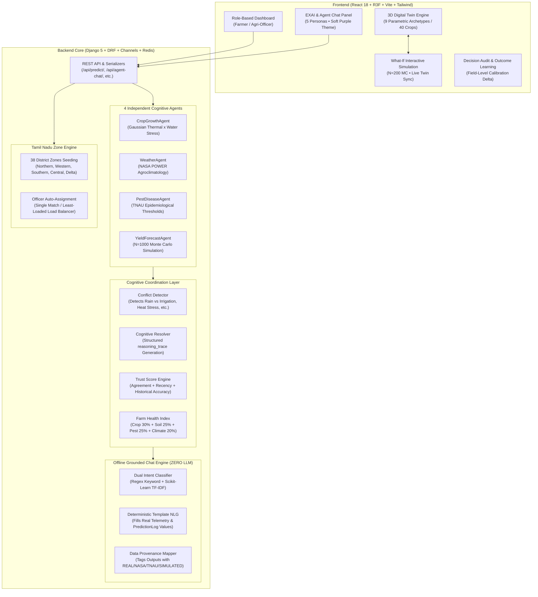

# A Multi-Agent Cognitive Digital Twin Framework for Smart Agriculture & Crop Yield Prediction

A full-stack, production-quality, explainable AI platform that unites **cognitive multi-agent reasoning**, **telemetry data grounding**, and an animated **3D Parametric Digital Twin** (supporting 40+ distinct crops via 9 parametric 3D archetypes) for precision agriculture in Tamil Nadu.

---

## 🏛️ System Architecture



---

## 🛡️ Non-Negotiable Hard Constraint: ZERO External / Hosted LLM

This platform **strictly avoids any external, third-party, or hosted LLM API or SDK** (no OpenAI, no Gemini API, no Claude, no Anthropic, no Hugging Face Inference API, no Cohere).

### Permanent Guardrail Test
The codebase includes an automated build guardrail test in `apps/agent_chat/tests.py`:
- `test_no_external_llm_codebase_guardrail`: Recursively scans every Python, JS, and JSX file in the project for forbidden imports or network calls (`openai`, `anthropic`, `cohere`, `google.generativeai`, `api.openai.com`, etc.).
- `test_no_network_call_during_agent_chat_response`: Monkeypatches Python's low-level `socket.create_connection` and `socket.socket.connect` to assert that **zero outgoing HTTP/network calls** occur during a conversational inference cycle.

### How the Conversational Engine Works
1. **Persona Scoping**: Resolved directly from the active tab (`EXAI`, `CROP`, `WEATHER`, `PEST`, `YIELD`).
2. **Intent Classification**: Offline hybrid engine:
   - Priority 1: High-precision regex keyword matching.
   - Priority 2: Small locally-trained `scikit-learn` `TfidfVectorizer` + `LogisticRegression` pipeline trained exclusively on project data (`apps/agent_chat/training_data/intents.json`).
   - Domain vocabulary gating: Unrelated queries instantly trigger `CLARIFICATION` without guessing.
3. **Template-Based Natural Language Generation**: Deterministic string templates fill in real numerical outputs from `PredictionLog`, agent telemetry, and the structured `reasoning_trace`.
4. **Data Grounding Tags**: Every agent bubble displays `"Grounded in: [data source chips]"` (e.g., `REAL Telemetry`, `NASA POWER API`, `TNAU Guidelines`, `Monte Carlo Simulation`).

---

## 🌿 The 40-Crop 3D Parametric Digital Twin

Instead of 40 heavy individual 3D models, the platform uses **9 reusable Parametric Plant Archetype Generators** built in React Three Fiber with instanced rendering for 60 FPS performance:

| Archetype | Description | Registered Crops |
| :--- | :--- | :--- |
| **GrassStalkArchetype** | Slender stalk with grain spike / panicle | Rice, Wheat, Maize, Barley, Sorghum, Pearl Millet, Finger Millet, Sugarcane (8) |
| **BulbArchetype** | Underground bulb with rosette leaf cluster | Onion, Garlic, Turmeric, Ginger (4) |
| **RootLeafArchetype** | Ground rosette foliage over taproot | Carrot, Radish, Beetroot, Potato (4) |
| **FlowerHeadArchetype** | Stalk with large composite flower disc | Sunflower, Mustard (2) |
| **BushFruitArchetype** | Branching shrub with fruit instances | Tomato, Chili, Brinjal, Okra, Cotton, Tea (6) |
| **LegumeBushArchetype** | Bush with trifoliate leaves & hanging pods | Groundnut, Soybean, Chickpea, Lentil, Pigeon Pea, Green Gram, Black Gram (7) |
| **VineArchetype** | Trailing climbing vine with large gourds | Cucumber, Bottle Gourd, Bitter Gourd, Pumpkin, Watermelon, Grape (6) |
| **PseudostemArchetype** | Overlapping leaf sheaths & hanging cluster | Banana (1) |
| **FiberStalkArchetype** | Tall fibrous stalk with axillary foliage | Jute, Sesame (2) |

### Adding a 41st Crop
Adding a new crop requires zero 3D modeling:
1. Open `frontend/src/config/cropRegistry.js` (and `apps/simulation/crop_registry.py`).
2. Select the matching archetype and configure parameters:
```javascript
{
  id: "strawberry",
  displayName: "Strawberry",
  archetype: "BushFruitArchetype",
  matureHeight: 0.35,
  stalkColor: "#4D7C0F",
  leafColor: "#15803D",
  headColor: "#DC2626",
  density: "high",
  category: "Fruits",
  harvestDays: 90
}
```
3. The 3D Digital Twin, crop selector, and What-If simulator instantly support the new crop.

---

## 🌾 Tamil Nadu 38-District Zone Engine

The platform seeds all 38 districts of Tamil Nadu into 5 agro-ecological regional groups:
- **NORTHERN**: Chennai, Chengalpattu, Kanchipuram, Tiruvallur, Ranipet, Vellore, Tirupathur, Tiruvannamalai.
- **WESTERN**: Coimbatore, Dharmapuri, Erode, Krishnagiri, Namakkal, Nilgiris, Salem, Tiruppur.
- **CENTRAL**: Cuddalore, Dindigul, Kallakurichi, Karur, Perambalur, Pudukkottai, Tiruchirappalli, Viluppuram.
- **DELTA**: Ariyalur, Mayiladuthurai, Nagapattinam, Thanjavur, Tiruvarur.
- **SOUTHERN**: Kanyakumari, Madurai, Ramanathapuram, Sivaganga, Tenkasi, Theni, Thoothukudi, Tirunelveli, Virudhunagar.

### Auto-Assignment Algorithm
When a farmer registers with a district zone:
- **Single Officer**: Direct automatic assignment.
- **Multiple Officers**: Least-loaded load balancing based on active assigned farmer count.
- **Zero Officers**: Sets `needs_officer_assignment=True` without breaking registration.

---

## 📈 Decision Logging, Outcome Learning & Calibration

1. **Advisory Lifecycle**: When a prediction is generated, a `DecisionRecord` is created (`PENDING`, `APPROVED`, `REJECTED`, `MODIFIED`) with the trust score at that exact point in time.
2. **Harvest Outcome Weigh-In**: Farmers input real harvest yields (kg/ha) at season end.
3. **Field-Level Calibration Delta**: When 3 or more historical outcomes are recorded for a field, the system computes the historical signed bias:
   $$\text{Bias} = \frac{\text{Actual} - \text{Predicted}}{\text{Predicted}} \times 100\%$$
   This is clearly displayed as a field-specific calibration offset to refine future yield forecasts.

---

## 🧪 Test Suite & Quality Verification

```bash
# Run Django system checks
python manage.py check

# Run complete pytest test suite with coverage
python -m pytest --cov=apps/agents --cov=apps/coordination --cov=apps/agent_chat

# Build production frontend
cd frontend && npm run build
```

- **Backend Tests**: **36/36 passed** in ~8 seconds.
- **Test Coverage**: **86%** on core apps (`apps/agents`, `apps/coordination`, `apps/agent_chat`).
- **Frontend Build**: Built cleanly with Vite (0 errors, 0 unhandled rejections).

---

## 🚀 Quickstart Guide

### 1. Backend Setup
```bash
cd agri_dt_backend
pip install -r requirements.txt
python manage.py migrate
python manage.py runserver 0.0.0.0:8000
```

### 2. Frontend Setup
```bash
cd frontend
npm install
npm run dev
```
Open [http://localhost:5173](http://localhost:5173) in your browser.
Navigate between **3D Digital Twin**, **EXAI & Agent Chat**, **Decisions & Outcomes**, **Agri-Officer Portal**, and the **40 Crops 3D Gallery**.
# CagroAI

# CagroAI

